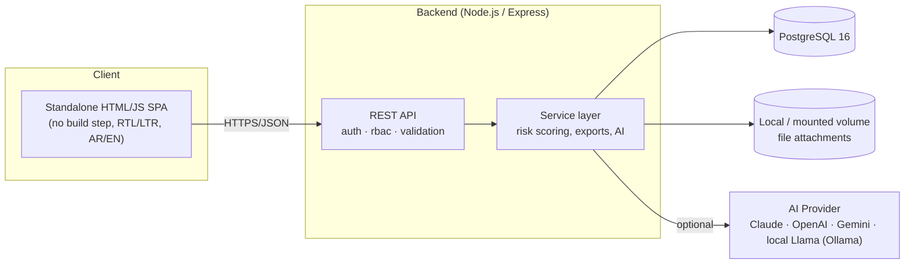
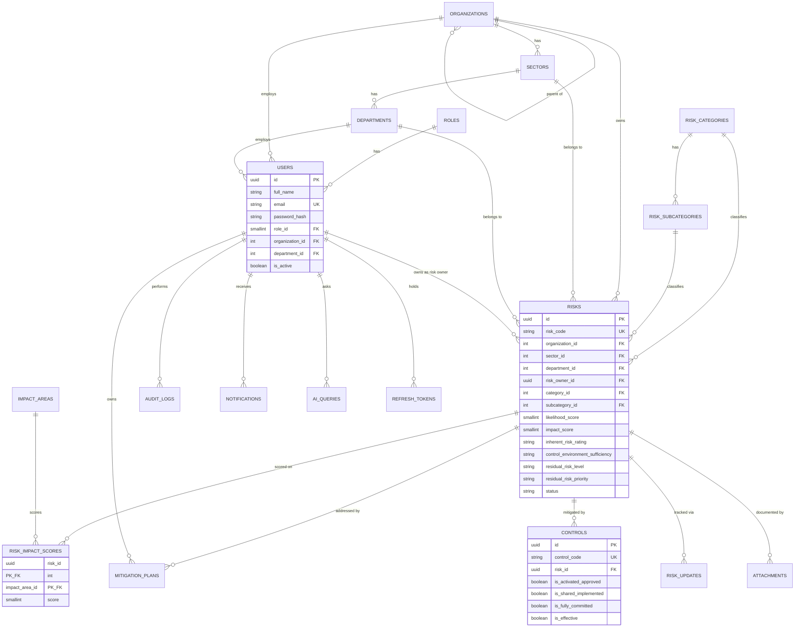

# Asir Health Cluster — Enterprise Risk Management System (ERMS)
## System Architecture

Digitizes the cluster's Enterprise Risk Register (previously an Excel workbook,
`سجل مخاطر تجمع عسير الصحي`) into a full web application: risk identification,
likelihood/impact scoring against 24 impact areas, control-environment
assessment, residual-risk rating, mitigation tracking, dashboards, and an
AI assistant that can suggest mitigation plans.

## 1. High-level architecture

- **Frontend**: plain HTML + vanilla JS (ES modules), Tailwind CSS and
  Chart.js **vendored locally** (no CDN at runtime) so the app works fully
  offline / inside restricted hospital networks. Hash-based router, i18n
  dictionary (Arabic default, English toggle) with automatic RTL/LTR
  switching.
- **Backend**: Node.js + Express, layered as
  `routes -> controllers -> services -> models -> PostgreSQL`.
- **Database**: PostgreSQL 16, normalized to 3NF (see ERD below).
- **AI integration**: a single adapter (`src/utils/aiProvider.js`) switches
  between Anthropic Claude, OpenAI, Google Gemini/Vertex, or a self-hosted
  local Llama model via Ollama — selected purely by the `AI_PROVIDER`
  environment variable, no code changes needed.

## 2. Tech stack & justification

| Layer | Choice | Why |
|---|---|---|
| Frontend | Vanilla JS + ES modules, Tailwind (compiled, vendored), Chart.js | Zero build tooling, opens as static files behind any web server, fully auditable, no supply-chain surface from a JS framework/bundler; still modular via ES module imports. |
| Backend | Node.js 20 + Express | Lightweight, huge middleware ecosystem, easy to containerize, matches the JSON-heavy CRUD/reporting workload. |
| Database | PostgreSQL 16 | Strong relational integrity for a regulated risk register (FKs, checks), JSONB for audit diffs, `pg_trgm` for fast free-text risk search. |
| Auth | JWT (short-lived access + rotating refresh tokens) | Stateless access tokens scale horizontally; refresh tokens are hashed and revocable server-side. |
| AI | Provider-agnostic HTTP adapter | Lets the customer choose a cloud LLM (Claude/OpenAI/Gemini) or a fully on-prem local Llama model via Ollama, important for healthcare data residency requirements. |
| Deployment | Docker + docker-compose | Reproducible dev/prod parity; the frontend ships as a tiny nginx image with zero server-side logic. |

## 3. Entity-Relationship Diagram

Full DDL: [`db/schema.sql`](db/schema.sql). Reference data (roles, org
hierarchy, the 13 risk categories / subcategories and 24 impact areas
transcribed from the source workbook, and 3 demo risks): [`db/seed.sql`](db/seed.sql).

## 4. Risk scoring logic

Mirrors the source Excel workbook's methodology (`backend/src/utils/riskMatrix.js`):

1. **Impact score** = max of the scores (1–5) entered across whichever of
   the 24 impact areas apply to the risk.
2. **Inherent Risk Rating** = looked up from a 5×5 Likelihood × Impact matrix
   → منخفض / متوسط / عالي / حرج (Low / Medium / High / Critical).
3. **Control Environment Sufficiency** = derived from 4 yes/no control
   questions (activated & approved, shared & implemented, fully committed,
   effective without failure) → ضعيف / مقبول / جيد (Weak / Acceptable / Good).
4. **Residual Risk Level & Priority** = looked up from Inherent Rating ×
   Control Sufficiency → مستوى 1–4 (Level 1 = most severe) and a numeric
   priority. A risk landing on Level 1 or 2 is automatically flagged as a
   **top risk** and a notification is sent to the ERM manager.

All four steps recompute automatically on every risk/control update
(`riskService.recalculateAndPersist`), so the numbers can never drift out
of sync with the underlying inputs — this was validated end-to-end against
a running PostgreSQL instance during development.

## 5. API surface

See [`backend/src/routes`](backend/src/routes) for the full set. Summary:

| Resource | Endpoints |
|---|---|
| Auth | `POST /auth/register`, `/login`, `/refresh`, `/logout`, `/change-password` |
| Users | `GET/PATCH/DELETE /users`, `/users/me` |
| Risks | full CRUD `/risks`, `/risks/:id/updates`, `/risks/controls/:id`, `/risks/:id/mitigations`, `/risks/export/excel`, `/risks/export/pdf` |
| Lookups | `/lookups/{organizations,sectors,departments,categories,subcategories,impact-areas,roles}` |
| Dashboard | `GET /dashboard/summary` (KPIs + 4 chart datasets + overdue mitigations) |
| Notifications | `GET /notifications`, `POST /notifications/:id/read` |
| Attachments | `POST/GET/DELETE /attachments`, `/attachments/:id/download` |
| AI | `POST /ai/chat`, `POST /ai/risks/:id/suggest-mitigations` |
| Audit | `GET /audit-logs` (Admin/Manager only) |

Every write endpoint is behind JWT auth + role-based access control
(`ADMIN`, `MANAGER`, `RISK_OWNER`, `USER`) and is recorded to `audit_logs`.
